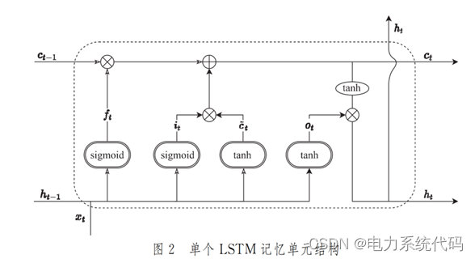
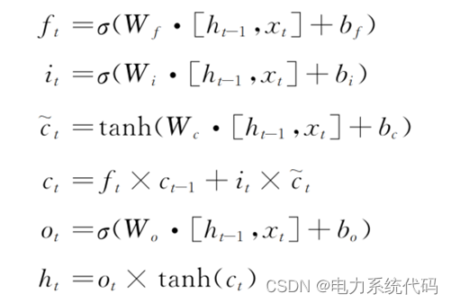
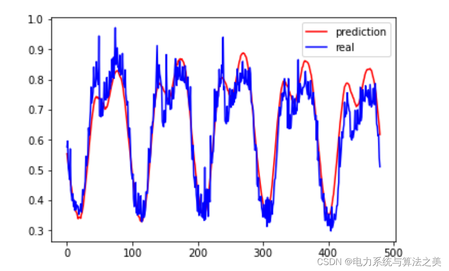
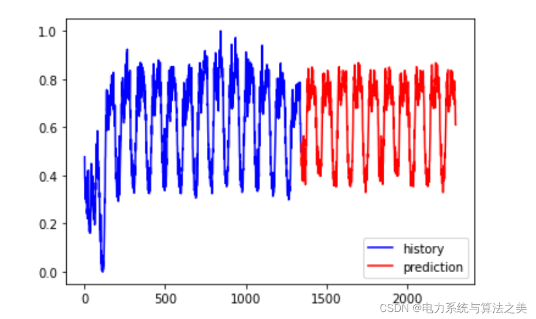

# Load Forecasting Based on LSTM Neural Network (Python Code Implementation)

​  
Contents
1. Overview
2. Load Forecast
3.LSTM  
4. Examples
5. Python code implementation
6. Results
Editor
1. Overview of power system load (power demand, i.e., active power) forecasting refers to the process of making predictions for future system loads, taking into account the influences of historical system loads, economic conditions, meteorological conditions, and social events, among others. Load forecasting is an important aspect of power system planning and dispatching. Short-term (within two weeks) forecasts are the basis for grid internal unit start-stop, dispatching and operational planning; Mid-term (future months) forecasts can provide support for the rational arrangement of power grid operations and maintenance decisions to ensure the production and social life electricity supply. Long-term (future years) forecasts can provide references for the formulation of plans such as grid renovation and expansion, thereby enhancing the economic and social benefits of the power system.
Complex and variable meteorological conditions, as well as unpredictable social events, can all have a certain impact on the power system load, making the application of traditional load forecasting models somewhat limited. Additionally, with the diversification of the power system load structure, the effectiveness of model applications has decreased, highlighting the urgent need for further research into power system load forecasting issues.
2. Load Forecasting: Power load forecasting is a typical time series regression prediction task. Power load forecasting is the foundation for ensuring the balance of power supply and demand, and provides information and basis for planning and construction of power grids, as well as operational decisions by power grid companies and users. Load forecasting is divided into long-term, medium-term, short-term, and ultra-short-term forecasting, with forecast targets including system loads and bus loads, organized by power grid companies. Large users should submit their main installed capacity, annual and monthly electricity consumption forecasts, and daily electricity load changes in accordance with relevant regulations.
3.LSTM  
Traditional RNN networks suffer from inherent defects in their structure, which lead to problems such as vanishing gradients and exploding gradients during parameter updates. This results in the loss of long-distance historical information, further causing the network to be extremely difficult to converge and unable to train an ideal model. LSTM, as an improved recurrent neural network, adds a cell state structure to the original network structure to control the transmission of global information. It also uses three types of gate units, including forget gate, input gate, and output gate, to control the update of the cell state information value. LSTM significantly alleviates the long-term dependency issues present in traditional RNN models, reduces the loss of long-distance historical information, and produces more accurate prediction results. The specific model of LSTM is as follows:

The LSTM updates the weight matrix and bias parameters of the network through the following formula:

Example calculation based on the load data provided in the attachment for a certain region's power grid with a 15-minute interval: establish a medium-short term load forecasting model for the future 10 days with a 15-minute interval; provide the predicted load results for the next 10 days in the region and analyze its prediction accuracy.

Python code implementation:

This paper only showcases part of the code, with all code points available upon request.
# Split the training set and test set, 80% As training set\ntrain_size = int(len(data_X) * 0.8)\ntest_size = len(data_X) - train_size\ntrain_X = data_X[:train_size]\ntrain_Y = data_Y[:train_size]\ntest_X = data_X[train_size:]\ntest_Y = data_Y[train_size:]\n\n# SettingLSTMData types that can be recognized and formedtran_XA one-dimensional array with two parameters, train_YA one-dimensional array with a single parameter.tensorType\n\n# Output: OutputlistTranslatenumpy3D array, first dimension adaptive\ntrain_X = train_X.reshape(-1, 1, input_len)\ntrain_Y = train_Y.reshape(-1, 1, label_len)\ntest_X = test_X.reshape(-1, 1, input_len)\n# numpyArray conversiontensor\ntrain_x = torch.from_numpy(train_X)\ntrain_y = torch.from_numpy(train_Y)\ntest_x = torch.from_numpy(test_X)\n\n# EstablishLSTMModel, the first layer isLSTMNeural network, the second layer is a fully connected layer.。\nfrom torch import nn\nfrom torch.autograd import Variable\n\nclass lstm(nn.Module):\n    def __init__(self,input_size=input_len,hidden_size=input_len,output_size=label_len,num_layer=2):\n        super(lstm,self).__init__()\n        self.layer1 = nn.LSTM(input_size,hidden_size,num_layer)\n        self.layer2 = nn.Linear(hidden_size,output_size)\n    \n    def forward(self,x):\n        x,_ = self.layer1(x)\n        s,b,h = x.size()\n        x = x.view(s*b,h)\n        x = self.layer2(x)\n        x = x.view(s,b,-1)\n        return x\n\n  
6. Results  
Editing

## Images

<!-- PAYMENT_BLOCK -->

## Get this dataset

- Payment link (Stripe): [Buy now](https://buy.stripe.com/3cs8yP7sY87d0vu9AB)
- Payment QR code: 

<!-- /PAYMENT_BLOCK -->
